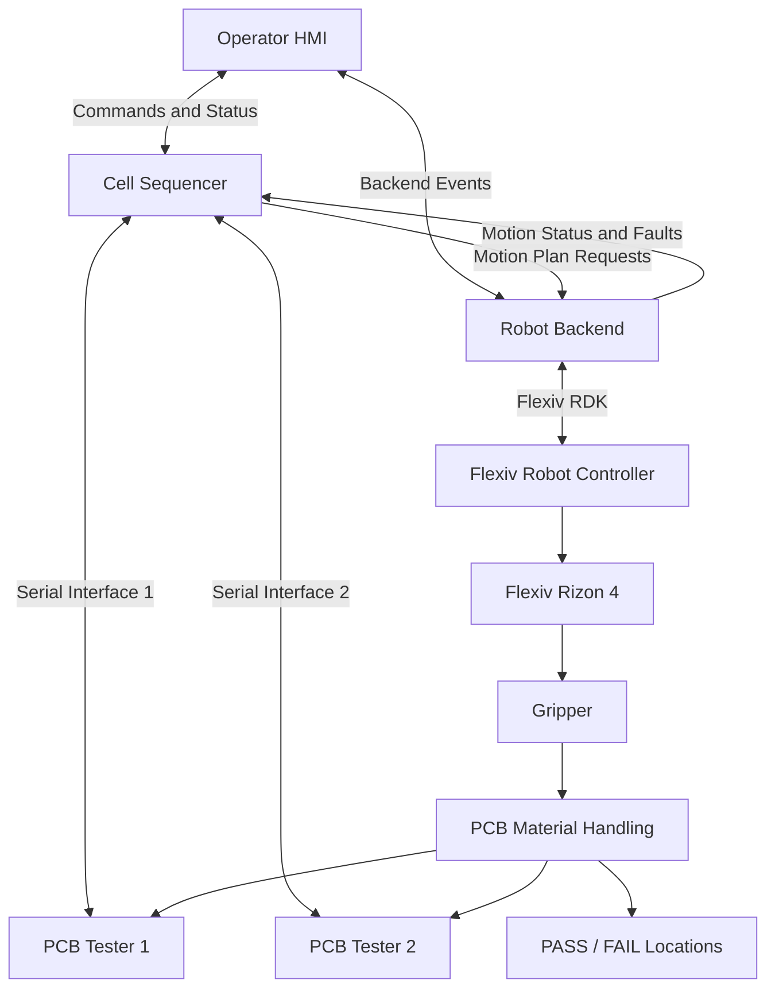
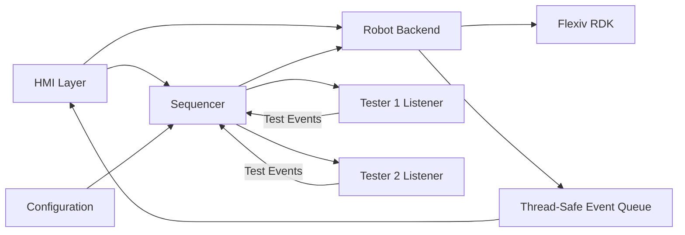
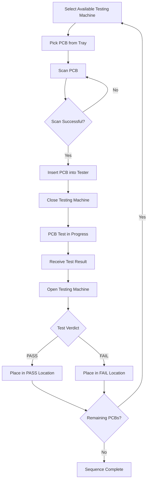
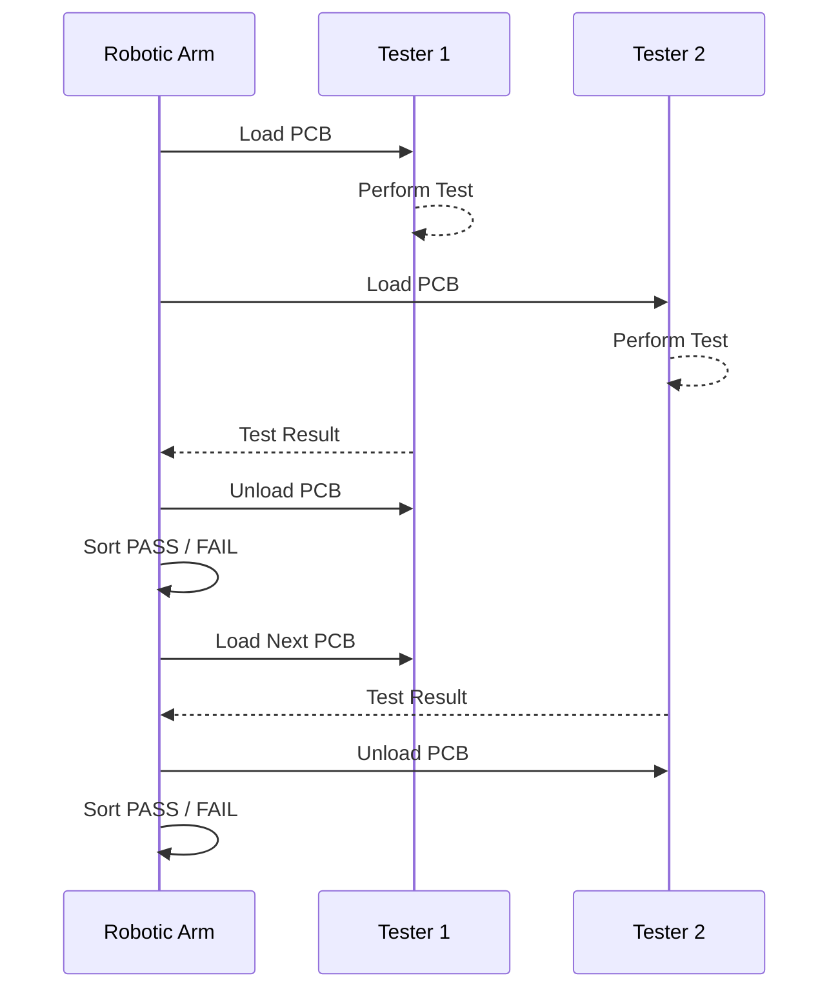

# 🤖 Automated PCB Testing Robotic Cell


---

## 📖 Project Overview

Development and integration of an automated robotic cell for printed circuit board (PCB) testing using a Flexiv Rizon 4 collaborative robotic arm.

The project involved developing a centralised Python-based controller application responsible for coordinating robotic movements, managing communication with multiple PCB testing machines and automating the complete PCB handling and testing workflow.

The system integrates industrial robotics, asynchronous machine communication, custom electromechanical mechanisms and a graphical operator interface.

Mechanical modifications and supporting automation mechanisms were also designed to enable the integration of existing testing equipment into the robotic cell.

---

## 🎬 System Demonstration

<p align="center">
  
  &nbsp;&nbsp;&nbsp;
  
</p>

<p align="center">
  
</p>


https://github.com/user-attachments/assets/8801377f-8390-4bd5-81b0-054fcda74666


---

## ✨ Key Features

- Centralised robotic cell controller.
- Automated PCB pickup, scanning, loading and unloading.
- Concurrent management of two PCB testing machines.
- Asynchronous machine communication.
- Automated PASS/FAIL sorting.
- Configurable robotic motion sequences.
- Multithreaded application architecture.
- Robot status and fault monitoring.
- Graphical human-machine interface (HMI).
- Custom mechanical fixtures and machine interface mechanisms.
- Electromechanical PCB tray-feeding system.
- Operator-controlled fault recovery.

---

## ⚙️ System Architecture



The system architecture separates operator interaction, robotic motion execution, machine communication and process sequencing into individual software modules.

This modular approach enables independent monitoring of testing machines while coordinating the shared robotic arm.

---

## 🦾 Robotic System Integration

The robotic cell utilises a Flexiv Rizon 4 collaborative robotic arm for PCB manipulation and interaction with existing testing equipment.

Robot communication is implemented through the Flexiv Robotics Development Kit (RDK), enabling the controller application to execute predefined robotic motion plans and monitor robot operation.

### Robot Control Functionality

- Robot connection and initialisation.
- Servo enabling and operational status verification.
- Named motion plan execution.
- Configurable velocity scaling.
- Motion completion monitoring.
- Pause, resume and software stop.
- Gripper initialisation and tool configuration.
- Digital output control.
- Fault detection and operator-requested fault clearing.

### Motion Execution

The controller executes predefined robotic motion plans through the Flexiv RDK.

Rather than defining individual robot trajectories within the application, the central controller coordinates smaller motion sequences, referred to as micro-plans, stored within the robot controller.

This separates the high-level process logic from the low-level robotic motion implementation.

---

## 💻 Central Controller Application

The controller application was developed in Python using a modular software architecture.

The application consists of four primary components:

| Component | Responsibility |
|---|---|
| HMI | Operator interaction and system monitoring |
| Sequencer | Workflow coordination and task scheduling |
| Robot Backend | Robot communication and motion execution |
| Configuration | Machine-specific motion plans and communication settings |

### Software Architecture



The software uses background threads, thread-safe event queues and synchronisation events to coordinate robotic operations and machine communication without blocking the graphical interface.

---

## 🧠 Robotic Cell Sequencing

[View sequencer source code](LegrandPCB/backend/sequencer.py)

The sequencer is responsible for coordinating the complete PCB testing workflow.

Individual machine states are maintained independently, allowing the robotic arm to service available testing machines while other machines are performing tests.

### Machine State Tracking

The sequencer tracks:

- Machine communication availability.
- Current PCB tray slot.
- PCB scanning status.
- Machine loading status.
- Active testing status.
- Test completion events.
- PASS/FAIL results.
- Completed PCB quantities.

### Automated Testing Workflow



Each robotic operation is executed as a predefined micro-plan, allowing the controller to monitor completion before progressing to the next dependent operation.

---

## 🔄 Dual-Machine Task Coordination

A key engineering objective was to minimise unnecessary robot idle time while PCB testing machines were operating.

The controller independently tracks the state of both machines and schedules robotic handling operations according to their availability.

While one machine is performing a PCB test, the robot can perform handling operations associated with the second machine.



This architecture allows testing operations to overlap while maintaining sequential access to the shared robotic arm.

---

## 🔌 Machine Communication

Communication with the PCB testing equipment is implemented using serial interfaces through the PySerial library.

Each testing machine has an independent communication listener operating in a background thread.

### Communication Configuration

| Parameter | Configuration |
|---|---|
| Communication interface | Serial |
| Python library | PySerial |
| Baud rate | 9600 |
| Independent communication channels | 2 |
| Serial read timeout | 0.2 seconds |
| Communication model | Asynchronous event-driven listeners |

### Machine Events

| Event | Function |
|---|---|
| SUCCESS | Confirms successful PCB scanning |
| PASS | Indicates a successful PCB test |
| FAIL | Indicates an unsuccessful PCB test |

Incoming machine messages are processed and converted into internal events used by the sequencer.

Communication availability is monitored independently for each machine, allowing the controller to determine whether it is available for operation.

Connectivity checks are designed to avoid transmitting additional probe messages during an active PCB test.

---

## 🖥️ Human-Machine Interface (HMI)

A custom graphical user interface was developed using Python and Tkinter to provide centralised control and monitoring of the robotic cell.

### Operator Functionality

- Robot connection and disconnection.
- Selection of configured machine setups.
- Start, pause, resume and stop operations.
- Robot velocity adjustment.
- Robot and gripper enabling.
- Fault clearing.
- Individual testing machine status monitoring.
- Process progress monitoring.
- Application and robot status logging.

The HMI receives asynchronous backend events through a thread-safe queue, allowing the interface to remain responsive during robotic operations.

The interface processes queued events approximately every 50 milliseconds.

<p align="center">
  
</p>

---

## 🛡️ Fault Monitoring & Operational Control

The robot backend incorporates continuous monitoring of robot operating conditions.

[View robot backend source code](LegrandPCB/backend/robot_backend.py)

### Implemented Functionality

- Background robot monitoring at approximately 10 Hz.
- Robot fault detection.
- Motion execution status monitoring.
- Robot operational status verification.
- Motion plan timeout handling.
- Pause-aware motion completion monitoring.
- Digital status indicator control.
- Controlled software stop.
- Operator-requested fault clearing and robot enabling.

### Configured Timeouts

| Parameter | Configuration |
|---|---|
| Robot motion plan timeout | 120 seconds |
| Recovery timeout parameter | 45 seconds |
| PCB test timeout parameter | 900 seconds |
| PCB scan confirmation wait | 2 seconds |

The recovery and test timeout parameters are defined within the sequencer configuration; their enforcement depends on the implemented workflow.

Automatic recovery movements are not performed by the current recovery function. Fault clearing and robot enabling remain operator-controlled.

Application-level monitoring and software stopping functions are not substitutes for safety-rated industrial robot safety systems.

---

## ⚙️ Mechanical Design & Equipment Integration

In addition to the controller application, custom mechanical assemblies and machine interface mechanisms were designed to support automated PCB handling.

Existing testing equipment required mechanical adaptation to enable reliable interaction with the collaborative robotic arm.

### Engineering Activities

- Mechanical design using Autodesk Fusion 360.
- Robotic cell layout development.
- Custom fixture design.
- Machine interface redesign.
- Electromechanical mechanism development.
- PCB positioning and presentation.
- Rapid prototyping.
- Physical integration and functional testing.


<p align="center">
  
  &nbsp;&nbsp;&nbsp;
  
</p>


---

## 📦 Electromechanical PCB Tray-Feeding System

A supporting electromechanical tray-feeding mechanism was developed to present PCB trays to the robotic arm and support automated material handling.

The mechanism was designed around a vertical tray presentation system, enabling trays to be positioned at an accessible robotic pickup location and removed following processing.

### Engineering Considerations

- Vertical load handling.
- Actuator and transmission selection.
- Lead screw-driven linear motion.
- Resistance to back-driving.
- Tray alignment and positioning.
- Mechanical stability.
- Manufacturing and assembly constraints.
- Integration with robotic pickup operations.

<p align="center">
  
  &nbsp;&nbsp;&nbsp;
  
</p>


### CAD Design Files

| File | Description |
|---|---|
| [ElevatorAssembly.f3z](ElevatorAssembly.f3z) | PCB tray elevator assembly |
| [Legrand Set up model v1.f3d](Legrand%20Set%20up%20model%20v1.f3d) | Robotic cell layout and assembly model |
| [MachineOpeningMech.f3d](MachineOpeningMech.f3d) | Testing machine opening mechanism |

---

## 🔬 Testing & Validation

Functional testing was performed on individual robotic operations and machine interfaces to support integration of the automated testing workflow.

### Demonstration Videos

- [Machine 1 Interface Test](Machine1InterfaceTest.mp4)
- [Machine 5 Test](Machine5TestVideo.mp4)
- [Machine 5 Additional Test](Machine5Test2.mp4)

### Functional Validation Areas

- PCB pickup and placement.
- Robotic interaction with testing equipment.
- Machine opening and closing mechanisms.
- PCB scanning workflow.
- Serial communication.
- Robot motion plan execution.
- Mechanical alignment and integration.

The repository contains demonstration footage, mechanical design files and controller application source code.

Quantitative cycle-time, throughput and reliability measurements are not currently documented.

---

## 📁 Repository Structure

```text
PCB-Testing-COBOT/
│
├── LegrandPCB/
│   ├── main.py
│   ├── run.sh
│   │
│   ├── backend/
│   │   ├── events.py
│   │   ├── robot_backend.py
│   │   └── sequencer.py
│   │
│   ├── config/
│   │   ├── settings.py
│   │   └── sequencer_profile.py
│   │
│   └── ui/
│       └── app.py
│
├── ElevatorAssembly.f3z
├── Legrand Set up model v1.f3d
├── MachineOpeningMech.f3d
│
├── Machine1InterfaceTest.mp4
├── Machine5Test2.mp4
├── Machine5TestVideo.mp4
│
└── README.md
```

### Software Components

| File | Description |
|---|---|
| main.py | Application entry point |
| robot_backend.py | Flexiv robot communication and motion management |
| sequencer.py | Dual-machine workflow coordination |
| events.py | Internal backend event definitions |
| settings.py | Robot and serial communication configuration |
| sequencer_profile.py | Machine-specific motion plans and tray configurations |
| app.py | Tkinter graphical operator interface |

---

## 🚀 Getting Started

### Development Environment

| Dependency | Version |
|---|---|
| Python | 3.10.12 |
| Tk / Tkinter | 8.6 |
| Flexiv RDK | 1.7.0 |
| PySerial | 3.5 |

### Clone Repository

```bash
git clone https://github.com/davidrcm1/PCB-Testing-COBOT.git

cd PCB-Testing-COBOT
```

### Install Dependencies

```bash
sudo apt install python3-tk

python3 -m venv .venv

source .venv/bin/activate

pip install pyserial==3.5 flexivrdk==1.7.0
```

Flexiv RDK installation may require a compatible operating system, Python version and vendor-supported SDK distribution.

### Configure Hardware

Update the configuration files:

- LegrandPCB/config/settings.py
- LegrandPCB/config/sequencer_profile.py

Configuration includes:

- Robot serial number.
- Network interface.
- Testing machine serial ports.
- Serial baud rate.
- Robot motion plan names.
- PCB tray slot configurations.

### Launch Application

```bash
python3 -m LegrandPCB.main
```

The application requires access to a compatible Flexiv robot controller, configured motion plans and testing machine interfaces for full operation.

Physical robot operation must only be performed within an appropriately commissioned and risk-assessed robotic cell.

---

## 🔬 Potential Future Development

- Dynamic task scheduling across additional testing machines.
- Automated production statistics and throughput monitoring.
- Persistent event and fault logging.
- Automated PCB traceability and result recording.
- Machine communication simulation.
- Unit and integration testing.
- Cycle-time optimisation.
- Expanded material handling automation.

---

## 🛠️ Technologies & Engineering Skills


---

## 👨‍💻 Project Contributor

**David Ceballos**

Mechatronics Engineer | Robotics & Autonomous Systems

[](https://github.com/davidrcm1)
